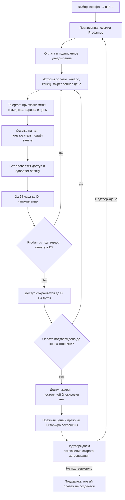

# Подписка сообщества: схема и проверка

Время — Москва. Деньги списывает Prodamus. Сервер использует дату следующего платежа из подписанного уведомления; расчётная дата помечается отдельно и не доказывает расписание банка.

Например: первая оплата 03.11.2026 в 15:37:22, следующая дата от Prodamus — 03.12.2026 в 15:37:22. Напоминание запланировано на 02.12 в 15:37:22. Без подтверждения оплаты доступ сохраняется до 07.12 в 15:37:22. Это пример, а не изменение чьей-либо подписки.

## Принятые правила

- Для ошибок очередного списания сохраняется общая отсрочка 4 суток. В старых карточках без новой подтверждённой отмены действует прежний расчёт; новая добровольная отмена не создаёт четыре дополнительных дня. Деньги и оплаченный срок при этом не дорисовываются. Бессрочные карточки исключены из списаний; карточки без даты требуют проверки.
- Планировщик проверяет напоминания раз в минуту. Доставка за 24 часа возможна при работающем сервере и доступном Telegram. После простоя напоминание догоняется в оставшемся окне до D. После D запоздалое «завтра спишется» не отправляется.
- Telegram и почта подтверждаются отдельно. Недоставленный канал повторяется, успешно доставленный — нет. Без Telegram id бот написать не может: необходим Start/привязка аккаунта.
- Удаление из чата выполняется после конца дополнительного доступа. Повторная проверка исключает администраторов, бессрочных участников, неизвестные даты и пользователей с другой действующей карточкой. Оплата во время проверки отменяет исключение.
- Удаление доступа не отменяет договор Prodamus. При поздней подтверждённой оплате доступ восстанавливается, и человек может снова подать заявку по ссылке. Принудительно добавить пользователя Telegram бот не может.
- Цена сохраняется в `priceLock` вместе с ID плана Prodamus. При повышении публичной цены нужно создать НОВЫЙ план Prodamus и сохранить прежние планы без переоценки. Изменение цены самого старого плана в Prodamus обойдёт обещание прежней цены; код предупреждает о несовпадении реальной оплаты с закреплённой ценой.
- Неизвестная историческая цена сохраняется, но отсутствующий ID плана не выдумывается: такой случай передаётся на проверку. Удаление персональных данных может лишить систему возможности автоматически сопоставить прежнюю карточку; доказательство тарифа тогда проверяется поддержкой.
- Если индивидуальная сумма не совпадает со стоимостью найденного исторического плана (например, 530 ₽ вместо 690 ₽), автоматическая ссылка на более дорогой план не выдаётся: требуется отдельный прежний план или проверенный способ сохранить скидку. Возвращаться по закреплённой цене следует через личный кабинет, а не публичную форму для новых подписчиков.
- При ручном переоформлении сначала требуется подтверждение отключения прежнего автосписания по всем известным ID из истории. Частичное подтверждение не считается полной отменой. Отказ Prodamus блокирует создание потенциально дублирующей подписки.
- Во время первой установки текущие просроченные активные карточки получают одинаковое переходное окно 4 суток от активации политики. Повторная установка не запускает это окно заново. Неизвестная дата не заменяется придуманной датой.

## Смена карты и проверка на личном аккаунте

Запрос смены карты создаёт обращение в поддержке. Реквизиты карты, CVV и банковские коды не собираются. Поддерживаемую самостоятельную замену карты через API Prodamus подтвердить пока не удалось: официальный сайт документации недоступен из среды (HTTP 403 от сетевого прокси). Неизвестный API и фиктивные ссылки для смены карты не используются.

Личному аккаунту можно отправить помеченное тестовое сообщение с пятью этапами: оплата, напоминание, ошибка, конец отсрочки, возврат по старой цене. Демо не меняет настоящую подписку, метки и участие в чате. Оно не заменяет проверку реального банковского списания и ручной оплаты на стороне Prodamus.

## Тесты и оставшиеся проверки

`node server/tests/reliability.test.mjs` — регрессии прежнего режима с явно заданной нулевой отсрочкой.

`node server/tests/subscription-lifecycle.test.mjs` — новая единая отсрочка, миллисекундные границы, цена, повторная доставка и конкурирующая оплата.

`node server/tests/http-reliability.mjs` и `--no-payment-keys` — подписи, доступ, ошибки и отмена.

`node server/tests/http-reliability.mjs --lifecycle` — полный цикл через реальные маршруты приложения с заглушками Prodamus/Telegram и управляемым временем. Реальных списаний, приглашений и исключений нет.

На живой системе нужно подтвердить расписание/повторы списаний Prodamus, доступность прежних планов, одну историческую карточку без даты и тарифы без подтверждённого ID. Подтверждение вебхука до завершения его обработки остаётся отдельным риском: устойчивую очередь приёма ещё нужно реализовать. Демо и тесты с заглушками не подтверждают реальное банковское списание.

## Установка одним запуском

Входная точка — `scripts/setup-community-subscriptions.mjs`, запущенная из отдельной папки Git-релиза с `node --env-file=server/.env` в рабочей папке сайта. Установщик проверяет совместимость файлов и JSON, права бота, адрес Telegram-вебхука и точного получателя теста; при необходимости запрашивает его `@username` в терминале. Аккаунт должен предварительно нажать Start в боте. По одному имени без подтверждения числового Telegram id сообщение не отправляется.

Перед заменой выполняются тесты и сборка. Создаётся приватная копия; при ошибке код возвращается, более новые платежи не заменяются старой копией. После миграции включаются напоминания, уведомления об ошибках и исключение после отсрочки. Проверяются работающий API и фактически отдаваемый интерфейс, затем отправляется тестовое сообщение только выбранному аккаунту. Итог показывает числа карточек без даты, без известного прежнего плана и без Telegram id. Повторный запуск не продлевает переходное окно заново.

Изолированная проверка нового цикла охватывает 20 HTTP-сценариев: оплату, метки, заявку в чат, точные границы напоминания и отсрочки, отказ отмены, повышение публичной цены, возврат и повторный вебхук, защиту Telegram-вебхука, доступ к демо и обращение для смены карты. Отдельно проверены общие регрессии, частичная доставка напоминания, повреждение хранилища и установка с возвратом старого кода. Все пользователи, ответы банков и Telegram в этих тестах вымышленные.

## Обновление: добровольная отмена и месячное предложение

Новые подтверждённые добровольные отмены сохраняют доступ до оплаченного конца (и уже предоставленного дополнительного срока), но не создают новую отсрочку на четыре дня. Причина обязательна на сайте и сохраняется до запроса Prodamus; бот продолжает принимать причину текстом. Неподтверждённая отмена не меняет оплату и право доступа.

За сутки до окончания нового добровольно отменённого доступа бот/почта отправляют служебное напоминание с отдельным подтверждением доставки. Участнику с исходными 690 ₽ в месяц доступно персональное предложение 500 ₽ в месяц по существующему плану `2611880`. Сохранение предложения не включает оплату и не продлевает доступ. Новая оплата доступна после конца текущего доступа и подтверждения остановки старых списаний. После подписанного платежа эффективная цена 500 ₽ сохраняется при продлениях и повторной отписке; исходная цена остаётся в истории. Рекламный текст учитывает настройки рассылок; предложение видно в кабинете.

В новой публичной продаже остался один тариф — 690 ₽ в месяц. Старые 3/6 месяцев сохранены для существующих договоров, расчётов и персональных исторических условий. Удаление карточек, отмена старых договоров или перенос их сроков не выполняются.

При повторном обновлении уже настроенного сервера установщик не спрашивает получателя демо и не отправляет тестовое сообщение заново. Старые флаги демонстрации удаляются, реальные подписки и метки сохраняются.
