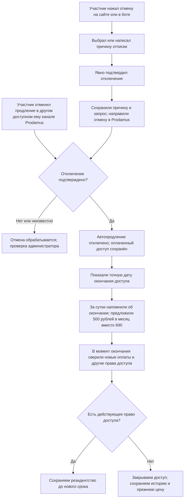
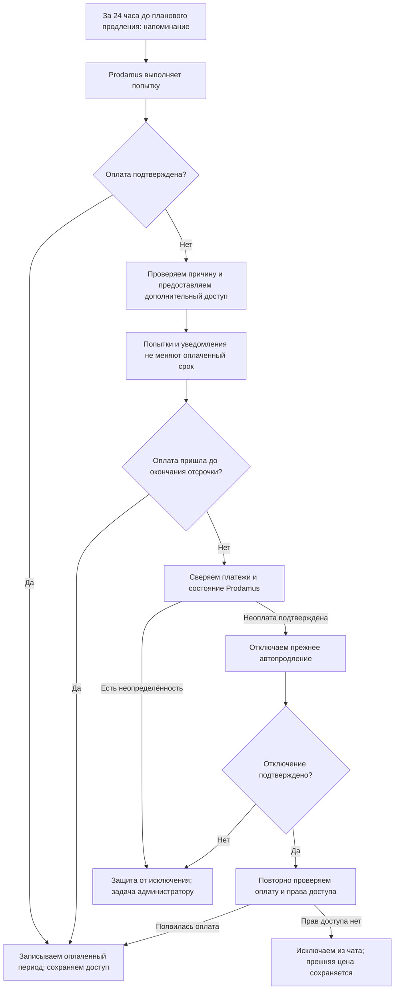

# Единая механика подписки, оплаты и доступа

Статус: проект общей механики от 03.11.2026; часть сценариев реализована в текущем изменении (см. ниже). Эти правила ещё не применены к работающему серверу. Текущая реализация описана в `community-subscription-lifecycle.md`; этот документ задаёт следующую доработку.

## 1. Кто за что отвечает

- Prodamus подтверждает платежи, возвраты, состояние автопродления, расписание и результаты попыток. Только подтверждённый платёж увеличивает учтённую оплату.
- Сервер хранит историю событий и по одним правилам рассчитывает срок доступа. Сайт, бот, обработчик заявок в чат и задача исключения используют один результат этого расчёта.
- Telegram-бот напоминает, показывает статус, одобряет заявки и выполняет рассчитанное закрытие доступа. Метки отображают состояние; ручное изменение метки не создаёт оплату и не меняет банковский договор.

Автоматическая отмена в конце дополнительного срока — бизнес-правило сервера. Бот не выбирает срок или судьбу участника самостоятельно.

## 2. Какие данные нельзя объединять в одно поле

| Сущность | Что храним | Что она означает |
|---|---|---|
| Участник | Внутренний ID, подтверждённый Telegram ID, связи с профилями Prodamus | Один человек может иметь несколько записей и оплаченных периодов |
| Подписка в Prodamus | ID профиля клиента, ID плана и доступный идентификатор экземпляра подписки | ID тарифного плана сам по себе не определяет человека или договор |
| Платёж | Внешний ID, сумма в копейках, валюта, время, результат, привязка к периоду | Неизменяемый финансовый факт; повторное событие не создаёт вторую оплату |
| Оплаченный период | Начало и конец, основание и источник дат | Какой интервал действительно оплачен |
| Следующее списание | Дата планового продления | Не является новой оплатой |
| Следующая попытка | Дата повторного запроса после отказа | Не продлевает оплаченный срок |
| Автопродление | Включено / отмена запрошена / отключение подтверждено / неизвестно | Состояние банковской подписки, независимо от доступа |
| Добровольная отмена | Причина, источник, время выбора, явное подтверждение, результат Prodamus | Причина сохраняется до отправки отмены; ответ провайдера фиксируется отдельно |
| Дополнительный доступ | Причина, начало, точный конец, основание решения | Отсрочка или ранее предоставленный бонус; не выручка и не платёж |
| Закреплённый тариф | Цена, валюта, длительность, старый план Prodamus | Право на прежние условия, сохраняемое после окончания доступа |
| Предложение возврата | Участник, продукт/срок, исходная цена, предложение 690 → 500 ₽ в месяц, новая цена, состояние и подтверждённый способ оплаты | Не является платежом, новым согласием на списания или основанием доступа |
| Чат | Есть право доступа / фактически в чате / ожидает заявки / ошибка Telegram | Платёж не доказывает, что Telegram уже добавил человека |

Для одного участника проверяются все его действующие права доступа: окончание одной карточки не даёт основания исключить человека, если другая ещё действует. Совпадение одного неуникального контакта не должно автоматически объединять разные банковские подписки.

Время хранится в UTC, показывается в Москве с часами и минутами. Интервал действует до указанного момента, не включая его: в сам момент окончания он уже завершён. Планировщик выполняет действие на ближайшем проходе; остановка сервера или Telegram может задержать фактическое исключение, но не меняет расчётный срок.

## 3. Единые правила доступа

`P` — конец подтверждённого оплаченного периода. Уже выданные бонусы и явно предоставленный дополнительный срок учитываются отдельно; отмена их не стирает.

| Сценарий | До какого момента сохраняется доступ | Что происходит с автопродлением |
|---|---|---|
| Оплата действует, продление включено | До P; затем новый платёж или разрешённая отсрочка | Prodamus выполняет списания по своему расписанию |
| Человек отменил продление до P | До P, либо до конца уже предоставленного бонуса | После подтверждения Prodamus отключено; новых четырёх суток за отмену нет |
| Разовая покупка доступа | До конца оплаченного периода и уже выданных бонусов | Автопродления изначально нет; автоматической отсрочки сбоя списания нет |
| Подтверждённый отказ очередного списания | Обычно до P + 96 часов | В течение отсрочки прежний договор сохраняется, возможны попытки Prodamus |
| Подтверждённая банковская блокировка | До более поздней даты: P + 96 часов или подтверждённое окончание блокировки + 24 часа | Дату списаний бот не меняет и блокировку не обходит |
| Отмена во время уже предоставленной отсрочки | До ранее предоставленного срока; он не начинается заново | Отключение подтверждается отдельно |
| Нет достоверных сведений об оплате или состоянии банка | Проверка с временной защитой от автоматического исключения | Администратор получает задачу; неопределённость не превращается в статус «отменено» |
| Бессрочный доступ | Бессрочно по отдельному основанию | Платежи и просрочка не применяются |

Одна отсрочка относится к одному неоплаченному периоду. Повторные ошибки, перезапуски и нажатия кнопок не переносят её начало. Если сбоя списания нет, истечение времени само по себе не должно классифицироваться как банковский отказ: перед закрытием нужна сверка.

72 часа берутся из ответа Prodamus. Пока не уточнено, с какого события они отсчитываются и меняют ли срок повторные ошибки, расчётная дата снятия блокировки помечается как предположение и требует проверки. `system_error` сам по себе не доказывает недостаток денег, временную блокировку или аварию магазина.

При неустранённой неопределённости создаётся задача с ближайшим сроком проверки не позже 24 часов и повторным уведомлением администратору. Это не бесконечное автоматическое продление подписки: каждое дальнейшее решение о дополнительном доступе фиксируется явно. Истечение срока проверки само по себе не является доказательством неоплаты.

## 4. Первая оплата и вступление

1. До подтверждённой оплаты карточка имеет состояние «ожидает оплаты». Кнопка клиента «я оплатил» создаёт запрос на проверку.
2. Подписанное событие сохраняется до подтверждения его приёма Prodamus. Обработка продолжится после перезапуска; один внешний платёж учитывается один раз.
3. Система записывает сумму и оплаченный интервал, закрепляет тариф, рассчитывает право доступа. Первую оплату за всю историю и начало текущего периода храним раздельно.
4. Участнику выдаётся ссылка на заявку в чат. Бот проверяет право доступа при каждой заявке и одобряет её только при положительном результате.
5. Подтверждённое действие Telegram меняет фактический статус участия. Отправленная ссылка не равна фактическому вступлению.

Если дата окончания отсутствует, допустим расчёт по подтверждённым условиям продукта с отметкой источника «расчётный». Противоречивые или неподтверждённые даты требуют проверки перед исключением. Отсутствие даты в одном уведомлении и цена 350/500 ₽ сами по себе не определяют, является ли продукт разовым.

## 5. Добровольная отмена — приоритетный сценарий

Запрос отмены сохраняется даже при недоступности Prodamus и безопасно повторяется с ограниченной частотой. Клиент видит «отмена обрабатывается», пока нет подтверждения. Успех по одному из нескольких действующих договоров не означает отмену всех остальных. Способ отмены должен однозначно относиться к нужному клиенту и подписке.

Пример: оплачено до **03.12.2026 15:37 мск**, отмена подтверждена **15.11.2026**. Доступ сохраняется до **03.12.2026 15:37 мск**; обычные четыре суток после этой даты не добавляются. Если заранее предоставлен отдельный бонус, показываем его фактическое окончание.

При ошибке отмены оплаченный доступ остаётся. Если к его окончанию состояние автопродления всё ещё неизвестно, исключение передаётся на проверку: нельзя одновременно обещать прекращение списаний и иметь действующий неподтверждённый банковский договор.

Платёж, пришедший после подтверждённой отмены, записывается и даёт соответствующий оплаченный доступ, но **не включает автопродление обратно**. Причина позднего списания проверяется отдельно; его нельзя молча игнорировать или автоматически считать новым согласием клиента.

### 5.1. Причина перед отменой

В боте и кабинете один порядок: намерение отключить → выбор/ввод причины → явное подтверждение → запрос в Prodamus → результат. До завершения шага причины наш интерфейс не отправляет отмену. Он ясно показывает, что автопродление ещё включено; закрытие формы не считается отменой.

Причину можно указать одним нажатием: «Дорого», «Нет времени», «Не подошёл формат», «Проблема с оплатой» или «Другое». Для последнего варианта можно написать свой текст. Длинное объяснение не требуется. API проверяет наличие выбранной причины/текста, а не только наличие заполненной формы на экране.

Сохраняем причину, источник (бот/кабинет), время и подтверждённое действие пользователя до вызова Prodamus. При таймауте или перезапуске причина не теряется. Повтор запроса не создаёт новую отписку и не обнуляет скидку. В отчёте показываем выбранную категорию; все ответы нельзя безусловно сводить к «Другое».

Этот порядок управляет отменой через наши интерфейсы. Если клиент уже отключил продление в Prodamus или другим подтверждённым способом, принимаем отключение сразу. Недостающую причину можно запросить отдельно; отсутствие ответа не включает списания обратно и не задерживает учёт уже состоявшейся отмены.

### 5.2. Предложение за сутки: 500 ₽ в месяц вместо 690 ₽

Решение владельца заменяет первоначальную идею скидки 10%. В публичной продаже остаётся только 690 ₽ в месяц. Предложение возврата для этого тарифа — 500 ₽ в месяц на последующие периоды, включая возврат после перерыва. Используется существующий план Prodamus `2611880`; новые планы не создаются. Первоначальный месячный план — `2854597`.

- После добровольной подтверждённой отмены предложение готовится для участника с закреплёнными 690 ₽ за месяц. Для старых тарифов 350/500 ₽ и действующих 3/6 месяцев новая скидка не назначается.
- За 24 часа до фактического конца разрешённого доступа отправляется напоминание; персональные условия доступны в кабинете. Если осталось меньше суток, уведомление направляется сразу, с точной датой. После окончания доступа сообщение «завтра закончится» не отправляется.
- Перед отправкой повторно проверяются подписка и дата. Возобновление отменяет старое задание; доставка подтверждается отдельно по каждому каналу. Существующие настройки рекламных сообщений учитываются отдельно от служебного напоминания.
- Предложение закреплено за человеком и прежним месячным продуктом, без срока сгорания. Повышение публичной цены или повторная отписка не понижают 500 ₽ ещё раз и не отнимают сохранённую цену.
- Кнопка «Сохранить цену 500 ₽» фиксирует выбор. Она не создаёт платёж, не включает списания и не продлевает доступ.
- Чтобы не списывать деньги за пересекающийся оплаченный период, новый период оформляется после окончания текущего разрешённого доступа. Затем человек подтверждает оплату и условия автопродления на странице Prodamus.
- Перед выдачей ссылки проверяется отключение прежнего автопродления. Неподтверждённая отмена блокирует новый платёж. Цена, план и право на предложение берутся с сервера; присланная клиентом сумма игнорируется.
- После подписанного подтверждения оплаты 500 ₽ по согласованному плану сохраняется эффективная цена 500 ₽. Исходная цена 690 ₽ и история платежей не переписываются. Последующие уведомления, кабинет и продления используют эффективную цену.
- Если предложение не принято или сохранено без оплаты, доступ заканчивается в ранее указанное время. Поздняя подтверждённая оплата восстанавливает право на вступление.
- Старые планы на 3/6 месяцев остаются в учёте для действующих договоров и прежних персональных условий. Они удаляются из публичного выбора и не принимаются новым публичным оформлением. Массовой отмены или пересчёта старых оплаченных периодов нет.

Пример сообщения:

> Автопродление отключено. Доступ к сообществу закончится 3 декабря в 15:37 мск. Если решите остаться, для вас доступна постоянная цена 500 ₽ в месяц вместо 690 ₽. Цена сохранится и при возвращении после перерыва. Сохранение предложения не включает списания.

В кабинете доступны «Сохранить цену 500 ₽» и, после окончания текущего доступа, «Вернуться за 500 ₽». Непринятое предложение не задерживает отмену и не меняет её результат.

## 6. Неудачное списание и согласованное закрытие

Отмена по неоплате запускается после окончания предоставленного срока. Пока согласование с Prodamus не завершено, действует явно показанный статус проверки. Не создаём второй договор для обхода банковского отказа и не выполняем ручные списания без подтверждённого способа провайдера.

`last_attempt=yes` означает необходимость действия: бот сообщает, что автоматические попытки завершены, и показывает способ восстановления подписки. Доступ при этом сохраняется до уже предоставленного срока. Новая подписка создаётся только после проверки отключения старой, с прежним тарифом.

Непоступивший вебхук не доказывает неоплату. Для автоматического окончательного закрытия нужен подтверждённый способ сверки состояния у Prodamus. Наличие такого API/выгрузки и полноту его данных ещё надо проверить. До этого спорные случаи сверяются вручную, без выдуманного запроса к несуществующему API.

## 7. Как считать периоды и суммы

- Длительность месяца соответствует условиям конкретного продукта. Один месяц нельзя всегда заменять на 30 дней, а три месяца — на 90.
- Уведомление о следующей попытке не меняет P. Успешная оплата обновляет оплаченные интервалы по подтверждённому расписанию договора.
- Поздняя оплата действующего договора может относиться к периоду, начавшемуся в плановую дату. Дату нового конца не выбираем произвольно по времени получения вебхука.
- При новой подписке после завершения старой начало и конец определяются новым подтверждённым договором. Старую дату первой оплаты сохраняем как историю.
- Уже предоставленные дни отсрочки не прибавляются ещё раз к каждому следующему оплаченному периоду. Бонусы имеют собственное основание и не дублируются при повторной обработке.
- Сумма клиента и комиссия провайдера учитываются отдельно. Отсрочка, тест, оценочная запись импорта и обещание оплаты не добавляют выручку.
- Возврат/частичный возврат/оспаривание записываются отдельным событием с привязкой к платежу и периоду. Без подтверждённого правила частичный возврат не превращается автоматически в произвольное число дней доступа.

Учебные примеры, не реальные подписки; все даты — Москва:

| События | Результат расчёта |
|---|---|
| Оплачено до 03.12.2026 15:37; отмена 15.11 | Доступ до 03.12.2026 15:37; автоматической отсрочки нет |
| Списание 03.12.2026 15:37 не прошло | Обычная отсрочка до 07.12.2026 15:37 |
| При том же списании начало блокировки подтверждено 04.12.2026 15:37; её конец подтверждён через 72 часа | Дополнительный доступ до 08.12.2026 15:37, включая сутки на оплату |
| Договор подтверждает период 03.12.2026–03.01.2027; оплата поступила 05.12 | Оплаченный конец — 03.01.2027, а не автоматически 05.01.2027 |
| Старый договор закрыт; новый подтверждает период 10.12.2026–10.01.2027 | Доступ по новому периоду, прежняя цена за соответствующий срок |

## 8. Метки, Telegram и возвращение

| Условие | Метки и действия |
|---|---|
| Есть оплаченный доступ | «резидент», тариф, закреплённая цена; разрешено вступление |
| Продление отключено, оплаченный доступ ещё действует | «резидент» сохраняется; добавляется «автопродление отключено» |
| Предоставлена отсрочка | «резидент» сохраняется; добавляется «оплата ожидается», при подтверждении — «банковская блокировка» |
| Идёт проверка с разрешённым доступом | «резидент» сохраняется; добавляется «платёж на проверке» с основанием и задачей |
| Все права доступа завершились и закрытие подтверждено | Снимается текущее резидентство, фиксируется фактическое исключение; история оплат, тариф и цена не стираются |
| Новая подтверждённая оплата | Пересчитываются права и метки; при необходимости снимается блокировка и выдаётся ссылка на новую заявку |

Бот не может принудительно добавить человека в Telegram: восстановление права доступа и фактическое повторное вступление — два события. При оплате во время исключения выполняется повторная проверка, а при уже выполненном удалении — снятие блокировки и приглашение. Сбой Telegram не помечается как успешное исключение; действие повторяется, администратор видит ошибку.

Проверки учитывают бессрочных участников, администраторов чата, вторую действующую подписку и неоднозначные старые даты. Выход человека из чата сам по себе не отменяет автопродление и не аннулирует оплаченный период; кнопка отмены остаётся доступной отдельно.

Прежняя цена закрепляется за подтверждённым человеком и соответствующим продуктом/сроком. При повышении публичного прайса создаются новые планы Prodamus; старые планы не переоцениваются. Индивидуальная скидка должна быть подтверждена доступным способом провайдера: нельзя обещать 530 ₽ и выдавать план на 690 ₽. Личность при возврате проверяется; один сменяемый Telegram-ник недостаточен.

## 9. Согласование событий и защита от расхождений

1. Входящее событие проверяется по подписи и сохраняется в устойчивую очередь до ответа HTTP 200. При невозможности сохранить — отказ, чтобы провайдер повторил доставку.
2. Финансовый факт обрабатывается один раз по устойчивому ключу. Дубликаты не увеличивают деньги, дни и число уведомлений.
3. События не обязаны приходить по порядку. Старый отказ не отменяет свежую оплату; позднее успешное списание не отменяет подтверждённую отписку. Неопределённый порядок изменений автопродления требует сверки с провайдером.
4. Рассчитывается желаемое состояние доступа, затем создаются задачи Telegram и уведомлений. Их неудача не откатывает оплату.
5. Перед исключением и сразу после него повторно сверяется версия оплаченного периода. Возможные гонки обрабатываются восстановлением доступа, а не потерей платежа.
6. В кабинете и сообщении бота показываются одни и те же четыре значения: оплачено до, доступ до, состояние автопродления, ближайшее подтверждённое списание/попытка.
7. Ежедневная сверка выявляет оплату без доступа, доступ без действующего основания, отмену без подтверждения и несоответствие фактического состава чата. Срочные проблемы не ждут ежедневного отчёта.

Несколько одинаковых ошибок у разных клиентов — сигнал для проверки общего инцидента, а не доказательство сбоя Prodamus. На время проверки исключение затронутых подписок приостанавливается; решение и срок следующей проверки видны администратору.

## 10. Изменения относительно текущего кода

Проверен исходный код на коммите `c1f3557`, а не состояние удалённого сервера.

| Сейчас | Требуемое поведение |
|---|---|
| `accessUntil()` добавляет четыре дня и активным, и отменённым/разовым карточкам | Отсрочка предоставляется по событию сбоя; добровольная отмена до окончания оплаты не создаёт четыре новых дня |
| `nextPaymentAt` служит одновременно датой продления и концом доступа | Оплаченный период, дата планового списания, повторная попытка и дополнительный доступ разделены |
| `recordPayment()` возвращает общий статус `active` | Оплата изменяет финансовый период, но не включает отменённое автопродление |
| В боте причина спрашивается до отмены; сайт/API допускают пустую причину | Наши интерфейсы требуют причину перед подтверждением; внешняя подтверждённая отмена учитывается независимо от опроса |
| Персонального предложения перед концом доступа нет | Для добровольной отмены месячных 690 ₽ предлагаем существующие 500 ₽ в месяц за сутки до окончания доступа |
| Неудачное списание хранится как последняя общая ошибка | Коды, причина, исходный период, первое ограничение и подтверждённый конец блокировки записаны отдельно |
| Исключение после отсрочки не отменяет договор Prodamus | Окончательное закрытие по неоплате согласуется с подтверждённым прекращением автопродления |
| Вебхук подтверждается до окончания обработки без устойчивой очереди | Доставка переживает перезапуск, согласование Telegram повторяется отдельно |

## 11. Порядок реализации и приёмка

1. Устойчивая доставка событий, разделение банковского состояния и доступа, единый расчёт периодов.
2. Добровольная отмена: подтверждение, сохранение срока, предупреждение и исключение по окончании доступа.
3. Отсрочка, банковские блокировки и согласованное закрытие после неоплаты.
4. Сверка фактического чата, меток, кабинета, истории и закреплённой цены.
5. Миграция старых карточек: не менять историю денег, не придумывать отсутствующие даты, не отнимать уже явно обещанный дополнительный срок. Правила новой отсрочки не запускаются заново при установке.

Будущие проверки приёмки; они описаны здесь как требования, а не уже выполненные тесты:

- Первая оплата, заявка в чат и фактическое одобрение.
- Повторное и запоздалое событие оплаты.
- Отмена на сайте/в боте и внешняя отмена в Prodamus до окончания доступа.
- Ошибка и частичное подтверждение отмены, безопасный повтор запроса.
- Ни одного лишнего дня за добровольную отмену; сохранение ранее выданного бонуса/отсрочки.
- Платёж после отмены без автоматического включения автопродления.
- Обычная ошибка, блокировка, неизвестный код, окончание попыток.
- Повторная ошибка не перезапускает отсрочку; повторная установка не создаёт новый срок.
- Отмена по неоплате и исключение только после согласования.
- Новая оплата во время исключения и восстановление после сбоя Telegram.
- Два договора одного участника, бессрочный доступ и неизвестная старая дата.
- Перезапуск после приёма события, недоступность банка, недоставленное уведомление.
- Возврат по прежней цене после повышения публичного прайса, без второго автосписания.
- Причина обязательна в наших интерфейсах; незаполненный запрос не направляется в Prodamus. Уже подтверждённая внешняя отмена не ждёт причины.
- Причина переживает ошибку Prodamus и перезапуск; её категория правильно попадает в отчёт.
- Предложение за 24 часа, отмена менее чем за сутки, повторная доставка и изменившаяся дата доступа.
- Предложение 690 → 500 ₽ применяется только к месячному тарифу, повторная отписка не снижает 500 ₽ ещё раз. Старые 350/500 ₽ и 3/6 месяцев сохраняют прежние условия.
- Выбор скидки без оплаты не продлевает доступ и не включает списания. Возобновление не создаёт немедленную вторую оплату за уже оплаченный срок.
- Отказ/игнорирование предложения сохраняют отмену; возврат после перерыва сохраняет персональную цену.
- Ссылка использует существующий месячный план Prodamus 2611880 на 500 ₽; последующие оплаты сохраняют 500 ₽. Публичные 3/6 месяцев закрыты для новых оформлений, а старые платежи учитываются.

В текущем изменении реализованы причина перед отменой на сайте, сохранение причины до вызова Prodamus, точный срок новых добровольных отмен, напоминание об окончании, предложение 690 → 500 ₽ и сокращение публичного каталога до 690 ₽. Устойчивая очередь вебхуков и специальный режим банковской блокировки остаются отдельными задачами. Для удалённого сервера требуется установка пакета; сам документ действий с подписками не выполняет.
